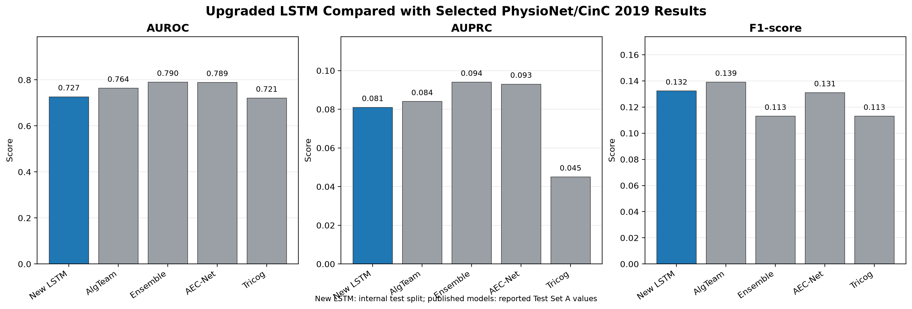
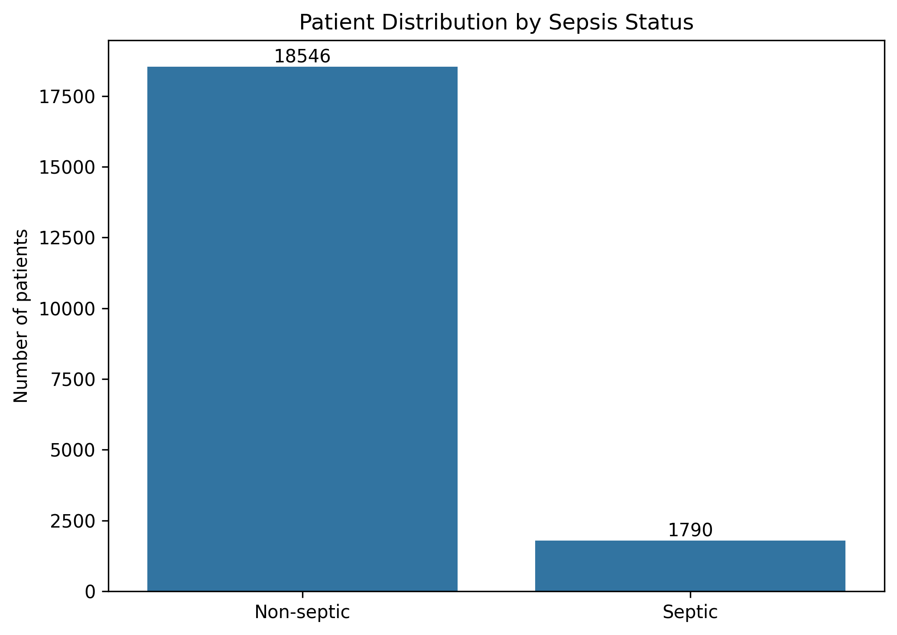
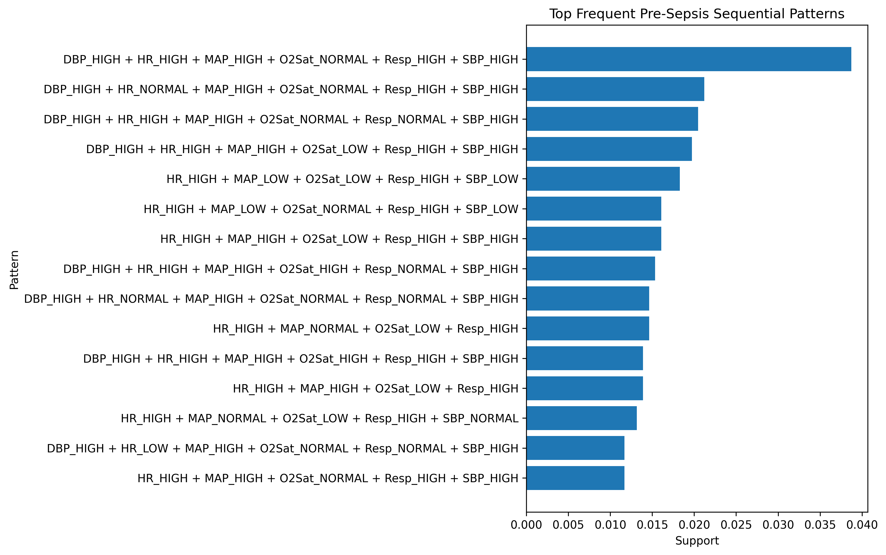
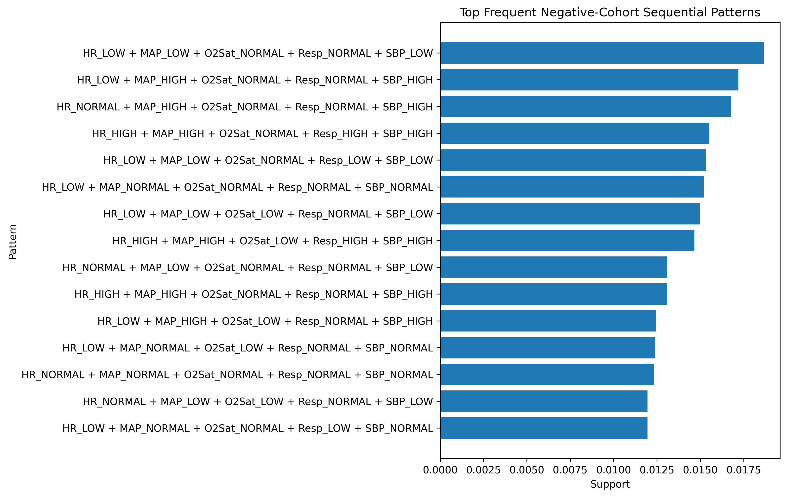
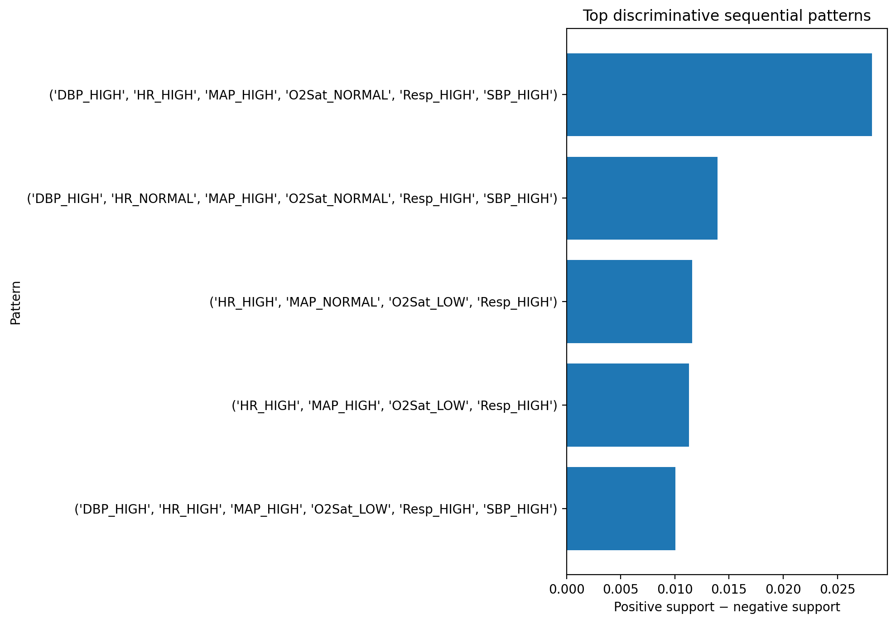
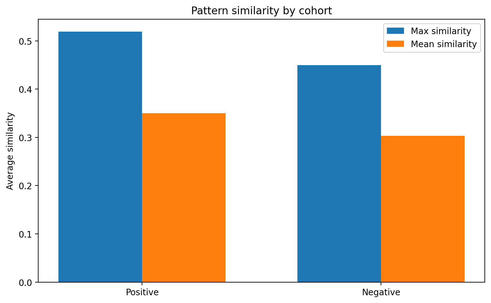

# Early Sepsis Detection Using Sequential Pattern Mining and Temporal Classification

An end-to-end sequential data mining pipeline for early sepsis detection from hourly ICU observations using the PhysioNet/CinC 2019 Sepsis Prediction Challenge Training Set A.


**Topics:** `sepsis-prediction` `sequential-pattern-mining` `time-series` `icu-data` `healthcare-ai` `prefixspan` `lstm` `bidirectional-lstm` `sequence-similarity` `jaccard-similarity` `machine-learning` `deep-learning` `data-mining` `physionet`

## Overview

This project develops an upgraded two-branch Bidirectional LSTM for early sepsis prediction from hourly ICU observations. The model combines a 24-hour continuous physiological sequence with window-level summary features, missingness indicators, temporal trends, and imbalance-aware training. Sequential pattern mining remains available as an interpretability and feature-analysis component, but the upgraded LSTM is the central predictive model.

```text
Raw ICU Time Series
        ↓
Exploratory Data Analysis
        ↓
Preprocessing & Symbolic State Generation
        ↓
Pre-Sepsis / Negative Sequence Windows
        ↓
Frequent Sequential Pattern Mining
        ↓
Closed Pattern Filtering
        ↓
Discriminative Pattern Selection
        ↓
Sequence Similarity & Distance Features
        ↓
Bidirectional LSTM Temporal Classification
        ↓
Sepsis Prediction & Evaluation
```

## Dataset

The project uses Training Set A from the PhysioNet/CinC 2019 Sepsis Prediction Challenge.

Analysed cohort:

| Statistic | Value |
|---|---:|
| Patients | 20,336 |
| Non-septic | 18,546 |
| Septic | 1,790 |
| Observation frequency | Hourly |

The raw dataset is not included in this repository.

## Methodology

### 1. Exploratory Analysis

The dataset is examined for patient-level sequence lengths, sepsis-label onset, class imbalance, missing observations, clinical-variable distributions, correlations and patient trajectories.

### 2. Symbolic Sequence Generation

Selected continuous clinical variables are converted into symbolic states using percentile-based thresholds:

```text
LOW / NORMAL / HIGH
```

An hourly observation can therefore contain states such as:

```text
HR_HIGH
MAP_HIGH
O2Sat_NORMAL
Resp_HIGH
SBP_HIGH
```

Pre-sepsis windows are constructed around the observed first positive sepsis-label hour for septic patients, while comparable windows are selected from non-septic patients.

### 3. Frequent Pattern Mining

Positive and negative cohorts are mined independently using PrefixSpan.

```text
Minimum support = 0.01
Maximum pattern length = 5
```

The strongest displayed positive-cohort pattern has support of approximately `0.039`, while the strongest displayed negative-cohort pattern has support of approximately `0.019`.

Example positive pattern:

```text
DBP_HIGH + HR_HIGH + MAP_HIGH +
O2Sat_NORMAL + Resp_HIGH + SBP_HIGH
```

### 4. Closed Pattern Filtering

Frequent mining can produce overlapping patterns containing redundant information. Closed-pattern filtering retains patterns for which no longer pattern contains the same pattern while maintaining identical support.

This reduces redundancy while preserving representative support information.

### 5. Discriminative Pattern Selection

Closed patterns are compared between the pre-sepsis and negative cohorts.

A pattern is retained when:

```text
Positive support ≥ 0.01
Support difference ≥ 0.01
Positive-to-negative support ratio ≥ 1.0
```

Five patterns satisfy the final criteria.

Their observed ranges are:

```text
Positive support:    0.0146 – 0.0387
Support difference:  0.0101 – 0.0282
```

The strongest selected pattern has positive support `0.0387` and support difference `0.0282`.

### 6. Sequence Similarity and Distance

Each selected pattern is compared with hourly itemsets using Jaccard-style similarity:

```text
Similarity(A,B) = |A ∩ B| / |A ∪ B|
Distance(A,B) = 1 - Similarity(A,B)
```

For every patient-pattern pair, minimum distance, maximum similarity, best matching position and mean similarity are derived.

The resulting feature matrix contains:

```text
19,855 instances
20 similarity/distance features
```

Average maximum similarity:

```text
Positive ≈ 0.52
Negative ≈ 0.45
```

Average mean similarity:

```text
Positive ≈ 0.35
Negative ≈ 0.30
```

### 7. Upgraded Temporal Classification

A 24-hour historical ICU window is used to predict the sepsis state in the following hour. Windows are split at the patient level so that observations from a patient cannot appear in both training and testing.

The recurrent branch preserves the hourly order of twelve clinical variables, including:

```text
HR, O2Sat, Temp, SBP, MAP, DBP, Resp,
FiO2, pH, Lactate, WBC, Creatinine
```

The model also uses window-level means, standard deviations, latest values, missingness rates, and temporal changes. Missing measurements are represented explicitly rather than treated as ordinary zeros.

A stacked Bidirectional LSTM learns temporal dependencies, while a dense branch processes the summary features. The two branches are merged for the final prediction. Weighted binary cross-entropy or focal loss addresses the strong class imbalance, and the decision threshold is selected using validation data.

## Current LSTM Results

| Split | AUROC | AUPRC | Accuracy | Precision | Recall | F1-score |
|---|---:|
| Split | AUROC | AUPRC | Accuracy | Precision | Recall | F1-score |
|---|---:|---:|---:|---:|---:|---:|
| Validation | 0.72003 | 0.06899 | 0.84804 | 0.07704 | 0.35053 | 0.12632 |
| Test | 0.72676 | 0.08095 | 0.85271 | 0.08148 | 0.35178 | 0.13231 |

These are the current results for the upgraded LSTM. Because septic cases are a minority class, accuracy should not be interpreted independently. AUPRC, precision, recall, F1, and the official PhysioNet utility score are the primary comparison metrics.

The project also keeps a benchmark table of published PhysioNet/CinC 2019 results in:

```text
outputs/evaluation/physionet_2019_participant_benchmarks.csv
```

The upgraded model writes its own checkpoints, metrics, predictions, and figures only under `output1/`.

## Evaluation Plots

The upgraded model is compared with selected published PhysioNet/CinC 2019
results using AUROC, AUPRC, and F1-score:



The source script is `src1/plot_comparison.py`, and the generated figure is
stored at `output1/figures/lstm_competition_comparison.png`.

## Repository Structure

```text
.
├── data/
│   └── training/
│       └── *.psv
├── notebooks/
│   ├── 00_EDA.ipynb
│   ├── 01_Preprocessing_and_Sequence_Building.ipynb
│   ├── 02_Sequential_Pattern_Mining.ipynb
│   ├── 03_Closed_and_Discriminative_Patterns.ipynb
│   ├── 04_Sequence_Distance_Features.ipynb
│   └── 05_Temporal_Classification.ipynb
├── outputs/                  # Existing analysis and benchmark artifacts
├── output1/                  # Upgraded LSTM artifacts only
├── src/                      # Existing analysis modules
├── src1/                     # Upgraded LSTM implementation only
├── requirements.txt
├── README.md
└── LICENSE
```

## Installation

Recommended environment:

- Python 3.9+
- Jupyter Notebook/JupyterLab
- NumPy
- pandas
- scikit-learn
- matplotlib
- seaborn
- TensorFlow/Keras
- PrefixSpan-compatible implementation

Install dependencies with:

```bash
pip install -r requirements.txt
```

## Dataset Setup

Place the required Training Set A PSV files under:

```text
data/training/
```

The raw dataset should not be committed to the repository because of its size and dataset-access requirements.

## Running the Project

The upgraded LSTM can be run directly with:

```bash
python src1/lstm_pipeline.py
```

Its outputs are written to `output1/`. The exploratory and pattern-mining notebooks remain available for analysis, but the new LSTM pipeline is the primary modeling workflow.

The analysis notebooks can still be run in order:

```text
00_EDA
→ 01_Preprocessing_and_Sequence_Building
→ 02_Sequential_Pattern_Mining
→ 03_Closed_and_Discriminative_Patterns
→ 04_Sequence_Distance_Features
→ 05_Temporal_Classification
```

Each stage generates intermediate outputs used by subsequent stages.

## Why This Approach?

The project combines three complementary components:

**Sequential pattern mining** discovers recurring physiological configurations associated with the pre-sepsis period.

**Pattern-based similarity** measures how closely a patient's recent physiological states resemble the discovered patterns.

**The upgraded two-branch Bidirectional LSTM** learns dependencies across ordered ICU observations while combining continuous measurements, missingness, trends, and summary features for the final prediction.

This produces a pipeline that combines interpretable physiological pattern discovery with temporal predictive modeling.

## Limitations

- The primary experiment uses Training Set A; Training Set B is available for later external validation.
- The dataset has substantial class imbalance.
- Missing clinical measurements are common and handled explicitly.
- Pattern discovery depends on support and discriminative thresholds.
- The official Challenge utility score requires hourly predictions rather than only fixed patient windows.
- Negative-window sampling may not represent every challenging non-septic case.
- The system is an academic research prototype and is not intended for clinical deployment.

## Visual Results

### ICU Data Overview



### Frequent Pre-Sepsis Patterns



### Frequent Negative-Cohort Patterns



### Discriminative Patterns



### Pattern Similarity by Cohort



### LSTM Competition Comparison


## Academic Context

**Course:** CSE 3068 – Sequential and Spatial Data Mining

**Project:** Early Sepsis Detection Using Sequential Pattern Mining and Distance-Based Classification on ICU Vital-Sign Sequences

## Disclaimer

This project is intended for academic and research purposes only. It is not a clinical diagnostic system and should not be used for medical decision-making.

## Author

**Salai Nimalan**  
Integrated M.Tech. Computer Science and Business Analytics
